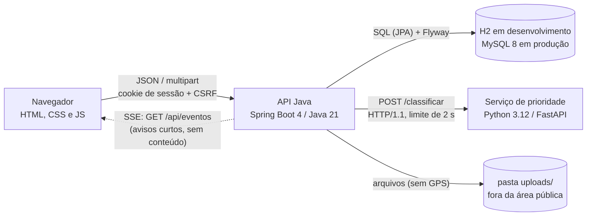
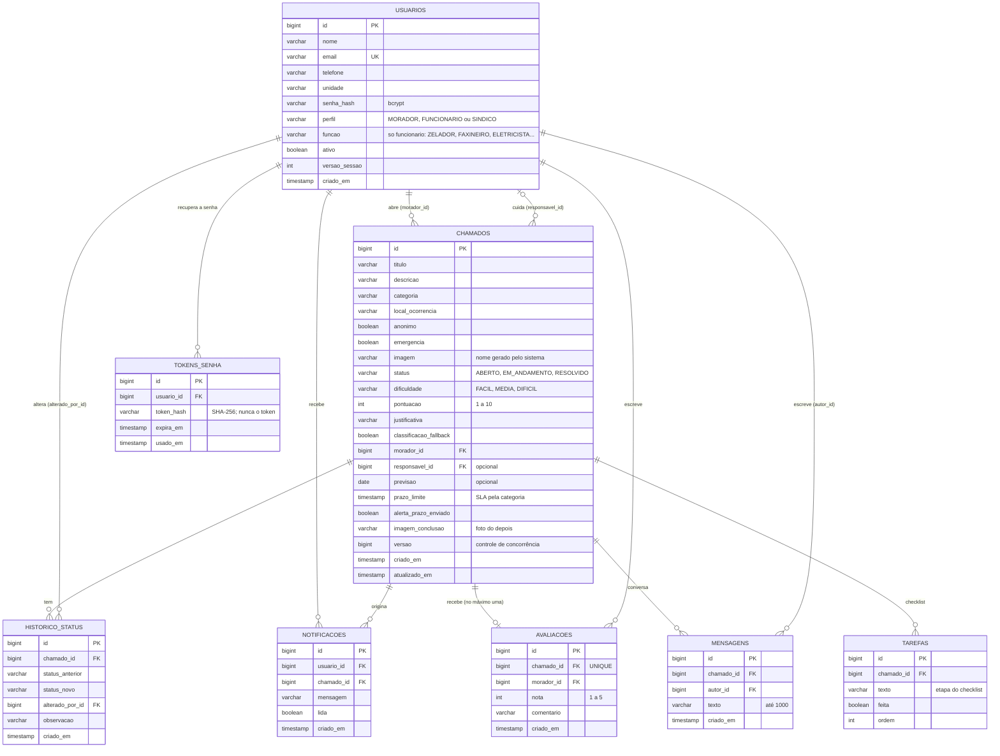
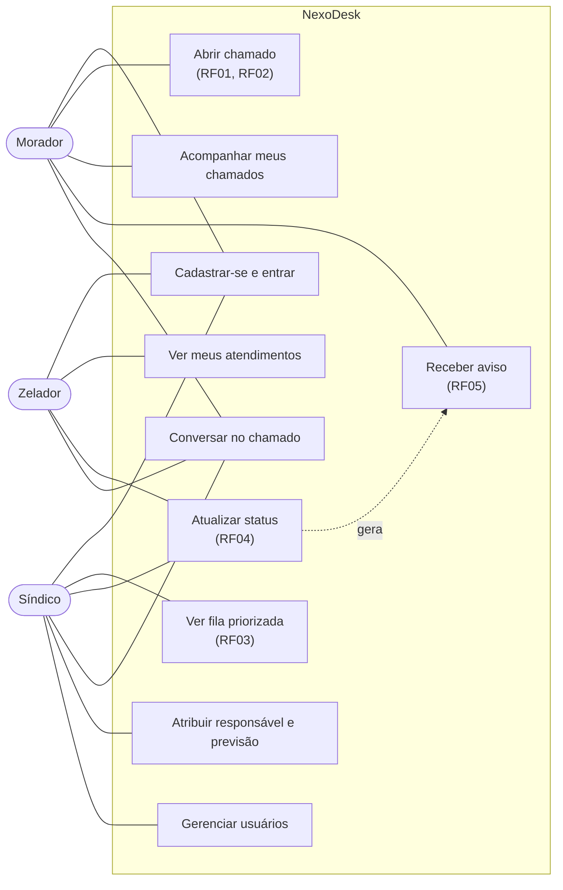
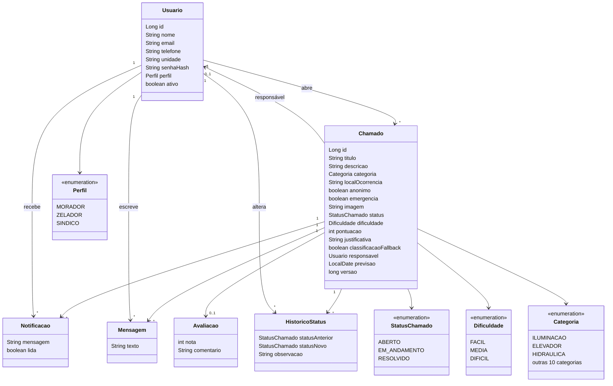
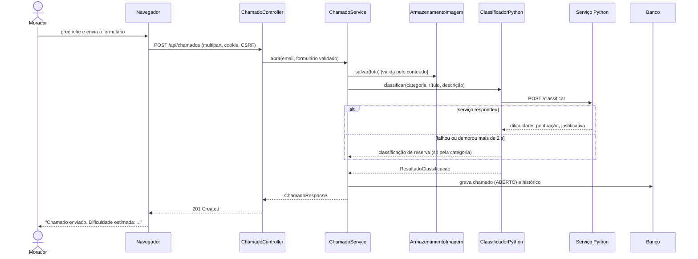
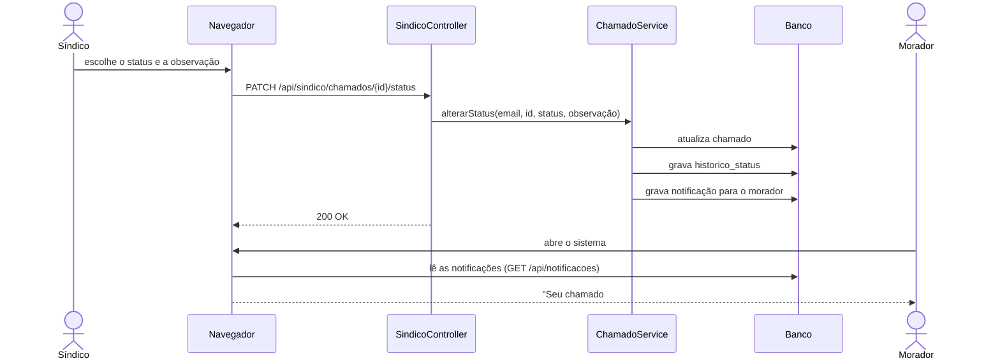

# NexoDesk: Documentação técnica

Projeto A3, Projeto e Engenharia de Software. Versão do documento: 22/10/2026 (fase 3: equipe por função, prazos, relatórios e nova aparência).
Código: este repositório (passo a passo de execução em [`../README.md`](../README.md); do protótipo antigo
para este, em [`migracao-do-aa.md`](migracao-do-aa.md)). Documentos irmãos: [`casos-de-prioridade.md`](casos-de-prioridade.md)
, [`roteiro-demonstracao.md`](roteiro-demonstracao.md), [`indicadores-medidos.md`](indicadores-medidos.md) e
[`ideias-futuras.md`](ideias-futuras.md) (o que ficou de fora e por quê).

> Tudo o que está marcado como **verificado** foi executado entre 14 e 22/10/2026 (comandos na seção 8).
> O que não foi executado aparece em **Limitações** (seção 9).

## 1. Visão geral

O NexoDesk é um helpdesk para condomínios. O **morador** abre chamados (com foto opcional), acompanha o andamento e
conversa com a equipe dentro do chamado. O sistema estima a **dificuldade** de resolver cada chamado e monta a **fila**
do síndico: **emergências primeiro**; depois do mais fácil para o mais difícil, com um **bônus de idade** para o chamado
difícil que espera muito não ser esquecido. O síndico atribui um **responsável** (ele mesmo ou um zelador) e uma
previsão. Tudo que muda aparece **na hora** nas telas abertas (tempo real) e gera aviso para quem precisa saber.

O sistema evoluiu do protótipo "Nexo" (PHP + PyQt5). O que foi mantido, trocado e descartado está em
[`migracao-do-aa.md`](migracao-do-aa.md).

Perfis: **morador** (cadastro público), **funcionário** (com uma função: zelador, faxineiro(a), eletricista, encanador, manutenção
geral, porteiro, segurança ou técnico externo; só vê os chamados atribuídos a ele) e **síndico** (acesso total, gerencia
usuários). Só o síndico cria outros perfis, promovendo uma conta existente.

## 2. Requisitos e onde estão implementados

| Requisito | Implementação | Situação |
|---|---|---|
| RF01 Cadastrar chamado (título, descrição, categoria) | `ChamadoController.abrir` → `ChamadoService.abrir`; tela `morador.html` | verificado |
| RF02 Classificar por nível de dificuldade | `servico-prioridade/app/regras.py` (Python) chamado por `ClassificadorPython` | verificado |
| RF03 Síndico vê a fila priorizada | `PrioridadeFila` (emergência → pontuação efetiva → mais antigo); tela `sindico.html` | verificado |
| RF04 Atualizar status (aberto, em andamento, resolvido) | `SindicoController` e `ZeladorController` → `ChamadoService.alterarStatus`; tabela `historico_status` | verificado |
| RF05 Notificar o morador | tabela `notificacoes` (aviso dentro do sistema) e e-mail por SMTP (`NotificadorEmailStatus`, desligado por padrão) | aviso interno verificado; e-mail verificado só contra servidor SMTP falso |
| RNF01 Resposta em menos de 3 s | chamada ao serviço Python com limite de 2 s e reserva automática | **medido**: pior caso 0,38 s (login com bcrypt); abrir chamado com o Python, em média 0,06 s. Em `localhost`, banco pequeno e um usuário por vez ([`indicadores-medidos.md`](indicadores-medidos.md)) |
| RNF01 (slides) Atualização em tempo real | Server-Sent Events: `PublicadorEventos`, `EventosTempoReal`, `js/tempo-real.js` (plano B: consulta a cada 15 s) | verificado por teste sobre HTTP real e no navegador com dois clientes |
| RNF02 Senha criptografada | bcrypt (`SecurityConfig.passwordEncoder`) | verificado |
| RNF03 Interface responsiva | `css/app.css`; conferida em largura de celular (375 px) | verificado |

### Funcionalidades além dos requisitos do relatório

| Funcionalidade | Onde | Situação |
|---|---|---|
| **Emergência fura a fila**: o morador marca, ou o Python detecta ("preso", "choque", "gás", "incêndio"...); selo vermelho e aviso imediato ao síndico | `regras.py` (`detectar_emergencia`), coluna `chamados.emergencia`, `PrioridadeFila` | verificado |
| **Bônus de idade** (anti-esquecimento): pontuação efetiva = pontuação − mínimo(3, dias ÷ 2); a dificuldade mostrada não muda; "atrasado" a partir de 7 dias | `PrioridadeFila`, `PrioridadeFilaTest` | verificado |
| **Conversa dentro do chamado** (morador, síndico, responsável); anonimato preservado; limite de 10 mensagens por minuto | `MensagemService`, `conversa.js`, tabela `mensagens` | verificado |
| **Equipe por função e atribuição assistida**: o síndico escolhe o responsável; o painel marca **"Indicado"** quem cobre a categoria (ex.: "sujeira no pátio" → zelador e faxineira) e mostra a **carga** de cada um. O sistema **não atribui sozinho** | `Funcao`, `UsuarioAdminService.equipe()`, `sindico.js` | verificado |
| **Emergência com telefones e segurança**: 190, 192, 193 e 199 (o sistema só **mostra** os números, não liga para ninguém) e aviso a quem tem a função Segurança | `ChamadoService.avisarSindicosDaEmergencia`, `EventosTempoReal`, `app.js` | verificado |
| **Prazo (SLA) por categoria** com selo "vence em..." e aviso único de prazo vencido (a cada 15 min) | `Categoria.getPrazoHoras`, `ChamadoService.alertarPrazosVencidos`, `AlertaDePrazoAgendado` | verificado |
| **Checklist por categoria e foto antes/depois** (a equipe marca etapas e anexa a foto do serviço pronto, sem GPS) | `ChecklistModelo`, `Tarefa`, `ChamadoService.anexarConclusao` | verificado |
| **Relatórios do síndico** (período, categorias, tempo médio, % dentro do prazo, por responsável), CSV e impressão | `RelatorioService`, `relatorios.html` | verificado |
| **Recuperação de senha por e-mail** (token de uso único, 30 min; o banco guarda só o hash) | `RecuperacaoSenhaService`, `EmailRecuperacao` | verificado contra servidor de e-mail falso; **nunca com provedor real** |
| **Contas de demonstração** (uma por função) e botões "Entrar como..." no login do perfil `demo` (sem senha) | `DadosDemonstracao`, `DemoController`, [`contas-demonstracao.md`](contas-demonstracao.md) | verificado |
| **Nova aparência** (menu por perfil, ícones e logotipo próprios, gráficos, passos do andamento, login com destaque) | `css/app.css`, `js/app.js` | contraste AA conferido por script (login, painel do síndico, relatórios, funcionário e morador) |
| **Gestão de usuários** (promover a funcionário com função ou a síndico, desativar, reativar, redefinir senha; nunca a própria conta nem o último síndico) | `UsuarioAdminService`, `usuarios.html` | verificado |
| **Busca e paginação da fila** do síndico (texto, categoria, 20 por vez; a posição exibida é a real na fila) | `sindico.js` | verificado no navegador com 37 chamados |
| **Responsável e previsão** do chamado; o zelador vê e atualiza só os dele | `ChamadoService.atribuir`, `ZeladorController`, `zelador.html`, migração V5 | verificado |
| **Privacidade (LGPD mínima)**: página de política e "excluir minha conta" (anonimiza os dados pessoais; os chamados ficam sem identificação) | `privacidade.html`, `ExclusaoDeContaService` | verificado |
| **Foto sem localização**: remove EXIF/GPS e recodifica | `ProcessadorImagem` | verificado |
| **Concorrência**: dois síndicos no mesmo chamado: o segundo recebe 409 em vez de apagar o trabalho do primeiro | `chamados.versao` (`@Version`) | verificado |
| **Sessão segura**: trocar a senha, desativar ou mudar o perfil derruba as outras sessões | `usuarios.versao_sessao`, `FiltroSessaoValida` | verificado |
| **Migrações de banco (Flyway)** e **integração contínua** (GitHub Actions: testes Java e Python a cada push) | `db/migration/V1..V5`, `.github/workflows/ci.yml` | migrações verificadas em H2 e MySQL; o arquivo da CI foi validado, mas **a primeira execução no GitHub depende do push** |
| Avaliação do atendimento (nota de 1 a 5 do morador, só em chamado resolvido, uma vez) | `AvaliacaoService`, tabela `avaliacoes`; média no painel do síndico | verificado |
| Minha conta (editar nome, telefone, unidade; trocar senha) | `AuthController` (`PATCH /api/auth/me`, `POST /api/auth/senha`), `conta.html` | verificado |
| Exportar a fila em CSV (abre no Excel), com responsável e previsão | `ExportadorCsv`, `GET /api/sindico/chamados/exportar.csv` | verificado |
| Acessibilidade: tamanho do texto, alto contraste, modo escuro, reduzir animações, fonte legível, link "pular para o conteúdo", um `h1` por tela | `js/acessibilidade.js`, `css/acessibilidade.css` | contraste (WCAG AA 4,5:1) conferido por script nas 3 aparências do síndico, morador e usuários; guardado por teste |
| Dados de demonstração (perfil `demo`) e script de inicialização (`iniciar-nexodesk.ps1`) | `DadosDemonstracao` | verificado |

## 3. Arquitetura



Camadas do backend Java (`api-java/src/main/java/br/nexodesk/`):

| Camada | Pacote | Responsabilidade |
|---|---|---|
| Apresentação | `web` | Controladores REST (`Auth`, `Chamado`, `Sindico`, `Zelador`, `Mensagem`, `Notificacao`, `Eventos`), objetos de entrada e saída (`Dtos`), tratamento de erros (`TratadorErros`) |
| Aplicação | `servico` | Regras de negócio: abrir chamado, fila, status, responsável, conversa, usuários, avisos, tempo real, guardar imagem, classificar |
| Dados | `repositorio`, `dominio` | Entidades JPA e consultas (Spring Data) |
| Configuração | `config` | Segurança (`SecurityConfig`, filtro de sessão, limitador de login), relógio injetável, criação do primeiro síndico |

**Decisão de projeto: Java + Python.** O Java concentra autenticação, regras e dados. O Python isola a
regra de dificuldade e a detecção de emergência (RF02), que mudam com mais frequência. Se o serviço Python cair, o Java classifica só
pela categoria (`ClassificadorLocal`, **sem** detecção de emergência) e marca `classificacaoFallback = true`; abrir chamado nunca fica bloqueado.

**Decisão de projeto: SSE e não WebSocket.** Só o servidor fala; a conexão usa o mesmo cookie de sessão e a CSP não muda.
O aviso não leva conteúdo: o navegador recarrega pela API normal, que já confere quem pode ver o quê. Os avisos saem só
**depois do commit** do banco. Limite assumido: vale para **uma instância** da API (várias exigiriam um barramento, como Redis).

## 4. Modelo de dados

Migrações (Flyway): `api-java/src/main/resources/db/migration/`:

| Versão | O que faz |
|---|---|
| V1 | esquema base (usuários, chamados, histórico, avisos, avaliações) |
| V2 | `chamados.versao` (concorrência) e `usuarios.versao_sessao` (derrubar sessões) |
| V3 | `chamados.emergencia` |
| V4 | tabela `mensagens` (conversa do chamado) |
| V5 | `chamados.responsavel_id` e `chamados.previsao` |
| V6 | `usuarios.funcao`; o perfil `ZELADOR` vira `FUNCIONARIO` + função `ZELADOR` (testado sobre banco da versão 5) |
| V7 | `chamados.prazo_limite` e `alerta_prazo_enviado` (prazo por categoria) |
| V8 | `chamados.imagem_conclusao` e tabela `tarefas` (checklist) |
| V9 | tabela `tokens_senha` (recuperação de senha; só o hash do token) |

Rodam sozinhas na inicialização; bancos criados antes do Flyway entram com baseline na versão 1.
Regra de ouro: **migração publicada nunca é editada**, só se cria uma nova (um teste confere o V1).



Pontos de projeto:

- A fila busca os chamados pendentes pelo índice `idx_chamados_fila (status, pontuacao, criado_em)` e a ordem final é decidida
  em `PrioridadeFila`: **emergência primeiro**, depois a pontuação efetiva (pontuação menos o bônus de idade), depois o mais antigo.
- `historico_status` guarda toda mudança (inclusive a abertura), formando a trilha de auditoria.
- `anonimo` esconde nome e unidade do **síndico e do zelador** (também nas mensagens); o morador continua dono do chamado.
- O Hibernate só **confere** (`ddl-auto=validate`) se as entidades batem com as migrações.
- `chamados.versao` (`@Version`) e `usuarios.versao_sessao` (invalida sessões ao trocar a senha, desativar ou mudar o perfil).
- Excluir a conta **não apaga** a linha de `usuarios` (os chamados precisam de dono): anonimiza nome, e-mail, telefone e unidade.

## 5. Regra de dificuldade (RF02) e fila

Implementada em `servico-prioridade/app/regras.py`, como funções puras (sem banco e sem rede).

1. Cada **categoria** tem uma pontuação base de 1 a 10 (por exemplo: Iluminação 2, Elétrica 6, Elevador 8, Estrutura 9).
2. **Termos** no título e na descrição somam ou subtraem pontos: gravidade (como "infiltração", "esgoto", "coluna"),
   abrangência (como "bloco inteiro"), necessidade de técnico (como "interfone", "motor", "sensor") e simplicidade, que subtrai
   (como "lâmpada", "trocar", "botão"). Perguntas e sugestões também subtraem.
3. A pontuação final é limitada de 1 a 10. Até 3 é **FÁCIL**, até 6 **MÉDIA**, acima disso **DIFÍCIL**.
4. O resultado traz uma **justificativa** em lista (ex.: `categoria ELEVADOR: base 8`, `termo 'preso': +2`),
   exibida ao síndico em "Por que essa dificuldade?".
5. **Emergência** é detectada à parte (`detectar_emergencia`), por expressões como "preso no elevador", "choque", "cheiro de gás",
   "incêndio", "desabamento", escritas para evitar alarme falso: "portão preso" **não** é emergência e "pessoa presa no portão" é; "taxa de gás" não é e "cheiro de gás" é.
   O morador também pode marcar a caixa "é uma emergência".

**Ordem da fila** (`PrioridadeFila`): emergência primeiro; depois a **pontuação efetiva** = pontuação − mínimo(3, dias de espera ÷ 2),
do menor para o maior; no empate, o mais antigo. A dificuldade exibida **não muda**; só a ordem. Chamado com 7 dias ou mais é
marcado "atrasado". Por que assim: se só o mais fácil passasse na frente, um chamado difícil poderia nunca ser atendido; e o
bônus é limitado a 3 pontos para a idade não virar urgência artificial.

**Validade da regra:** a regra foi ajustada com 27 casos (hoje todos batem, o que **não prova nada**, porque foi ajustada neles) e
conferida com 15 casos escritos depois, que ela nunca tinha visto: **11 de 15 (73%)**. Esse é o número a citar
(detalhes e os casos que erram em [`casos-de-prioridade.md`](casos-de-prioridade.md)). As expectativas dos casos ainda
**não foram validadas por um síndico real**.

A tabela de pontuação base existe também em `dominio/Categoria.java` (modo de reserva). O teste
`RegrasTest.pontuacaoBaseDoJavaEIgualAoPython` falha se as duas divergirem.

## 6. API

| Método e rota | Perfil | Função |
|---|---|---|
| `POST /api/auth/register` | público | cria conta de **morador** (o perfil nunca vem do cliente) |
| `POST /api/auth/login`, `POST /api/auth/logout`, `GET /api/auth/me` | público / logado | sessão por cookie |
| `GET /api/auth/sessao` | público | informa se há sessão, sem gerar erro 401 |
| `PATCH /api/auth/me` | logado | atualiza nome, telefone e unidade (e-mail e perfil não mudam) |
| `POST /api/auth/senha` | logado | troca a senha exigindo a atual (erro conta no bloqueio de tentativas); derruba as outras sessões |
| `POST /api/auth/excluir-conta` | logado | exclui a conta (anonimiza), exigindo a senha; o único síndico ativo não pode |
| `GET /api/categorias` | público | categorias do formulário |
| `POST /api/chamados` (multipart) | morador | abre chamado, com foto opcional e a marca de emergência |
| `GET /api/chamados/meus` | morador | lista os próprios chamados |
| `GET /api/chamados/{id}`, `GET /api/chamados/{id}/imagem` | dono, síndico ou zelador responsável | detalhe com histórico, e foto |
| `GET`/`POST /api/chamados/{id}/mensagens` | dono, síndico ou zelador responsável | conversa do chamado |
| `POST /api/chamados/{id}/avaliacao` | dono do chamado | avalia o atendimento (nota 1 a 5); só se RESOLVIDO e uma vez |
| `GET /api/sindico/chamados?status=ativos\|todos\|ABERTO\|EM_ANDAMENTO\|RESOLVIDO` | síndico | fila priorizada |
| `GET /api/sindico/chamados/exportar.csv?status=...` | síndico | a mesma fila em CSV (respeita o anonimato) |
| `PATCH /api/sindico/chamados/{id}/status` | síndico | muda status, gera aviso e e-mail (com `versao`, devolve 409 se a tela estava velha) |
| `PATCH /api/sindico/chamados/{id}/responsavel` | síndico | atribui responsável e previsão (ou remove) |
| `GET /api/sindico/equipe` | síndico | síndicos e zeladores ativos (quem pode ser responsável) |
| `GET /api/sindico/usuarios`, `PATCH /api/sindico/usuarios/{id}` | síndico | gestão de usuários: perfil e situação |
| `POST /api/sindico/usuarios/{id}/redefinir-senha` | síndico | "esqueci minha senha" sem e-mail: gera uma senha temporária de 12 caracteres, mostrada uma vez; só para morador ou zelador ativo; derruba as sessões da pessoa |
| `GET /api/sindico/estatisticas` | síndico | contagens por status e dificuldade, emergências pendentes |
| `GET /api/funcionario/chamados?status=ativos\|todos\|RESOLVIDO` | funcionário | "meus atendimentos" |
| `PATCH /api/funcionario/chamados/{id}/status` | funcionário | muda o status, só dos chamados dele (os outros dão 404) |
| `POST /api/funcionario/chamados/{id}/conclusao`, `POST /api/sindico/chamados/{id}/conclusao` | funcionário responsável / síndico | foto do serviço pronto (multipart, campo `imagem`) |
| `GET /api/chamados/{id}/imagem-conclusao` | dono, síndico ou funcionário responsável | foto do "depois" |
| `PATCH /api/funcionario/tarefas/{id}`, `PATCH /api/sindico/tarefas/{id}` | funcionário responsável / síndico | marca ou desmarca uma etapa do checklist |
| `GET /api/sindico/funcoes` | síndico | funções e as categorias que cada uma cobre |
| `GET /api/sindico/relatorio?de=&ate=`, `GET /api/sindico/relatorio.csv` | síndico | relatório do período (padrão 30 dias; máximo 366) |
| `POST /api/auth/esqueci-senha`, `POST /api/auth/redefinir-senha` | público | recuperação de senha por e-mail (resposta sempre igual; com freio de pedidos) |
| `GET /api/demo/contas` | público, **só no perfil `demo`** | contas de exemplo para o login (nunca devolve senha) |
| `GET /api/notificacoes`, `POST /api/notificacoes/{id}/lida` | logado | avisos do usuário |
| `GET /api/eventos` (SSE) | logado | fluxo de avisos de tempo real; até 5 conexões por usuário |

Erros saem sempre como JSON `{"erro": "...", "campos": {...}}`, sem detalhes internos.

## 7. Segurança

- **Senhas:** bcrypt; mesma mensagem de erro para e-mail inexistente e senha errada; tamanho de 8 a 72 caracteres.
- **Força bruta:** 5 senhas erradas para o mesmo e-mail e IP, ou 30 falhas de um mesmo IP, bloqueiam o login por
  15 minutos (HTTP 429). Trocar a senha e excluir a conta usam o mesmo contador. O contador fica em memória
  (reiniciar a API zera; atrás de proxy o IP visto é o do proxy).
- **Perfis:** cadastro público só cria morador. O primeiro síndico nasce na primeira execução
  (`InicializadorSindico`), com senha vinda de variável de ambiente ou gerada e mostrada uma única vez no console. Os demais
  perfis só por promoção feita por um síndico (nunca a própria conta, nunca o último síndico).
- **Sessão e CSRF:** cookie `HttpOnly` e `SameSite=Lax` (e `Secure` no perfil `prod`); CSRF ativo (cookie `XSRF-TOKEN` + cabeçalho
  `X-XSRF-TOKEN`). Trocar a senha, desativar, mudar o perfil ou excluir a conta **derruba as outras sessões** e fecha os fluxos de tempo real.
- **Cabeçalhos:** CSP restritiva (`default-src 'self'`), `X-Content-Type-Options: nosniff`, `X-Frame-Options: DENY`.
- **XSS:** o front-end insere texto do servidor só com `textContent`. O teste `PaginasEstaticasTest` varre as telas e reprova
  `innerHTML`, `eval`, script ou `style=` inline, manipuladores `onclick=`, recursos externos, campo sem rótulo e tela sem um único `h1`.
- **Zelador:** só enxerga e altera chamados atribuídos a ele; chamado de outro responde 404 (como se não existisse).
- **Tempo real:** o fluxo só abre com sessão válida; o aviso não traz conteúdo (só tipo e número do chamado); ao desligar a API todos
  os fluxos são fechados.
- **CSV:** texto que começa com `=`, `+`, `-` ou `@` recebe um apóstrofo na frente (senão o Excel executaria como fórmula);
  campos com `;`, aspas ou quebra de linha vão entre aspas.
- **E-mail:** sai só depois do commit e fora da requisição; o assunto não usa o título digitado pelo usuário e o corpo
  não leva a descrição do chamado; o log mascara o endereço. Credenciais SMTP só por variável de ambiente.
- **Upload:** tipo decidido pelo **conteúdo** (JPG, PNG ou GIF), a imagem é decodificada e gravada de novo **sem EXIF/GPS**, nome gerado
  pelo sistema, limite de 5 MB, pasta fora da área pública; só o dono, o síndico e o zelador responsável veem a foto. Se o banco recusar
  o chamado, a foto é apagada (sem arquivo órfão).
- **Isolamento:** morador que pede chamado de outro recebe 404.
- **SQL:** consultas parametrizadas (JPA), sem concatenação.

## 8. Testes e como reproduzir

| Suíte | Testes | Cobre |
|---|---|---|
| Java `FluxoChamadoTest` | 43 | cadastro, login, bloqueio por tentativas, sessão, CSRF, abertura e classificação, fila, emergência, envelhecimento, anonimato, status + aviso, conversa, avaliação, minha conta, troca de senha e sessões, concorrência (409), CSV, e-mail, isolamento, upload |
| Java `EquipeEResponsavelTest` | 23 | promover, rebaixar e desativar; funções (equipe com carga e categorias, só mudar a função não derruba a sessão, aviso à Segurança em emergência, "O eletricista respondeu"); redefinir a senha de morador ou funcionário (síndico não, nem a própria conta); atribuir responsável e previsão (avisos, limites, 409); área do funcionário (só os chamados dele, anonimato, 403 nas rotas dos outros perfis) |
| Java `RecuperacaoSenhaTest` | 5 | fluxo completo, resposta igual para qualquer e-mail, token de uso único, expirado ou inventado, link novo invalida o anterior, freio de pedidos |
| Java `RelatorioTest` | 3 | números do relatório conferidos contra dados criados pelo teste, período vazio e inválido, só o síndico |
| Java `ChecklistEConclusaoTest` | 3 | checklist criado uma vez, quem pode marcar etapas, foto do depois sem acesso de estranhos e arquivo falso recusado |
| Java `PrazoChamadoTest` | 2 | prazo vem da categoria (emergência 1 h), aviso de prazo vencido uma única vez, resolvido não avisa |
| Java `FuncaoTest`, `DemoContasTest` | 3, 1 | toda categoria tem função que a cubra; contas de demonstração sem senha |
| Java `ExclusaoDeContaTest` | 5 | excluir a conta: dados anonimizados, chamado mantido sem identificação, sessões caem, senha errada, CSRF, regra do último síndico |
| Java `TempoRealHttpTest` | 5 | fluxo SSE sobre HTTP real: sem sessão é recusado, o síndico vê chamado novo e emergência sem recarregar, o morador vê o status mudar e mais ninguém recebe, mensagem avisa só a outra parte, trocar a senha fecha o fluxo das outras sessões |
| Java `PublicadorEventosTest` | 10 | limite de conexões por usuário, batimento, conexão morta, encerramento no desligamento |
| Java `PrioridadeFilaTest` | 10 | ordem da fila, bônus de idade (limites e arredondamento), "atrasado", relógio injetado |
| Java `PaginasEstaticasTest` | 7 | guarda das 7 telas: CSP, XSS, rótulos, idioma, `h1` único e sem pular nível |
| Java `MigracoesBancoTest` | 4 | Flyway: V1 nunca muda, arquivos em sequência sem buracos, banco novo chega à última versão e passa na validação, banco criado antes do Flyway migra sem perder dados |
| Java `ArmazenamentoImagemTest` | 10 | tipo pelo conteúdo, remoção de EXIF/GPS, limites, arquivo falso |
| Java `ClassificadorPythonTest` | 9 | cliente do serviço Python (resposta válida, erro 500, valores inválidos, serviço fora do ar, HTTP/1.1, repasse da emergência detectada, a reserva em Java não inventa emergência) |
| Java `UsuarioAdminServiceTest` | 4 | regras do último síndico, sessão derrubada, chamado liberado sem simular banco |
| Java `LimitadorTentativasLoginTest` | 7 | janela de 15 min, limite por e-mail+IP e por IP, expiração, zerar no sucesso |
| Java `ExportadorCsvTest` | 5 | escape de campos e proteção contra fórmula |
| Java `EnviadorEmailSmtpTest` | 4 | envio SMTP real contra servidor falso local (GreenMail), falha do servidor não derruba |
| Java `DadosDemonstracaoTest` | 2 | perfil `demo` cria 8 chamados com histórico, avisos e um zelador, e não duplica |
| Java `CookieSeguroProdTest`, `ImagemOrfaTest`, `RegrasTest` | 2, 1, 3 | cookie `Secure` no `prod`; foto apagada se o banco recusa; pontuação base Java = Python |
| Python `test_regras.py` e `test_casos.py` | 20 | regras de dificuldade, emergência (com alarme falso), endpoint `/classificar`, os 27 casos de ajuste e os 15 de validação |

Total: **172 testes Java e 20 Python, todos passando (22/10/2026).** A suíte Java passou **nos dois bancos**: H2 em
memória (padrão, ~65 s) e **MySQL 8.4.9** real, a partir de banco vazio (Flyway V1 a V5; variáveis `NEXODESK_TEST_DB_*`, ver README). Nos dois, o Hibernate roda com `ddl-auto=validate`, ou seja,
recusa subir se as entidades não baterem com as migrações. Além deles, foram executados por HTTP e pelo navegador: o fluxo
completo com os dois serviços no ar, o perfil `demo`, o zelador (login, lista, mudança de status) e o tempo real com **dois
clientes** (o síndico, por script, muda um status e a tela aberta do morador atualiza sozinha, sem recarregar).

```powershell
cd api-java;           .\mvnw.cmd clean test
cd servico-prioridade; .\.venv\Scripts\python.exe -m pytest -q
```

Para executar o sistema inteiro com um comando (Java, Python e, se quiser, dados de exemplo):
`.\iniciar-nexodesk.ps1` ou `.\iniciar-nexodesk.ps1 -Perfil demo` (detalhes no README).

Defeito real achado e corrigido nesta fase: ao desligar a API com navegadores conectados, o desligamento esperava 30 s
(os fluxos SSE contavam como requisição em andamento). Agora todos são fechados no início do desligamento.

## 9. Limitações e próximos passos

- **E-mail de recuperação de senha:** testado contra servidor falso; com provedor real nunca. Sem e-mail configurado o link só aparece no log do perfil `demo`.
- **Emergência:** o sistema **não aciona** bombeiros, SAMU nem polícia; mostra os números e avisa a equipe interna. O "Indicado" é só sugestão (a regra função × categoria é uma tabela em código, não validada por síndico).
- **Aparência:** sem fonte própria (usa a do sistema, por causa da CSP e para não baixar arquivos); verificada em 375 px no morador, por script de contraste nas telas citadas; leitor de tela real não usado.
- **Sem teste de usabilidade com pessoas reais.** O roteiro e a planilha de cálculo do SUS estão prontos em
  [`teste-usabilidade/`](teste-usabilidade/roteiro.md), mas **nenhum teste foi aplicado**: não existe resultado de usabilidade
  e nenhum slide deve afirmar "alta aceitação".
- **Regra de dificuldade:** 73% em casos que ela nunca viu (15 casos escritos por uma pessoa só); as expectativas ainda não foram
  validadas por um síndico real. Detecção de emergência só no Python (a reserva em Java não detecta).
- **Tempo real:** as conexões ficam na memória de **uma instância** da API; para várias instâncias seria preciso um barramento (Redis).
- **E-mail (RF05):** implementado e testado contra um servidor SMTP falso, mas vem **desligado** e nunca foi testado com um
  provedor real (Gmail etc.). Ligar exige o perfil `email` e variáveis de ambiente (ver README).
- **RNF01:** medido só em `localhost`, com banco pequeno e uma pessoa por vez. Não há teste de carga (muitos usuários ao mesmo
  tempo) nem medição com o banco em outra máquina.
- **Checklist e foto:** o checklist é um modelo por categoria (não editável pelo síndico) e não bloqueia a conclusão; a foto do depois tem o mesmo tratamento da de abertura.
- **LGPD:** a página de privacidade e a exclusão de conta atendem o mínimo do projeto, mas **não foram revisadas por advogado**. O
  texto digitado em chamados e mensagens permanece depois da exclusão; não há prazo automático para apagar chamados antigos; o
  "li a política" do cadastro é uma confirmação na tela, não é registrada no banco.
- **Integração contínua:** o arquivo `.github/workflows/ci.yml` foi escrito e validado, mas só roda de verdade depois do push.
- Um único condomínio; sem HTTPS (necessário para publicar fora do `localhost`;
  o perfil `prod` já liga o cookie `Secure` e a leitura dos cabeçalhos do proxy; o HSTS vem do Spring Security quando a conexão é HTTPS).
- Auditoria de acessibilidade feita por **script** (contraste e estrutura) e revisão manual; **não** foi testado com leitor de tela
  de verdade (NVDA, VoiceOver) nem com o axe/Lighthouse.
- Fora do escopo, com o motivo de cada um: [`ideias-futuras.md`](ideias-futuras.md) (mural, reservas, financeiro, vários condomínios...).
- Os diagramas UML do relatório (Canva) precisam ser conferidos contra os desta documentação.

## 10. Diagramas UML

### 10.1 Casos de uso



> O relatório fala em 5 casos de uso; o código implementa os 10 acima (os 6 da fase 1 e 4 novos: conversar, atribuir, gerenciar usuários e meus atendimentos).

### 10.2 Classes (domínio)



### 10.3 Sequência: abertura de chamado



### 10.4 Sequência: mudança de status e aviso


