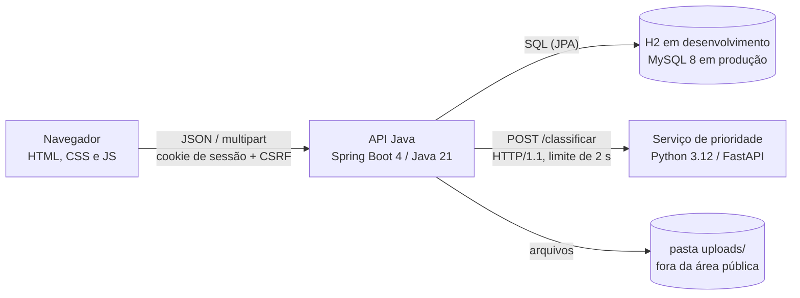
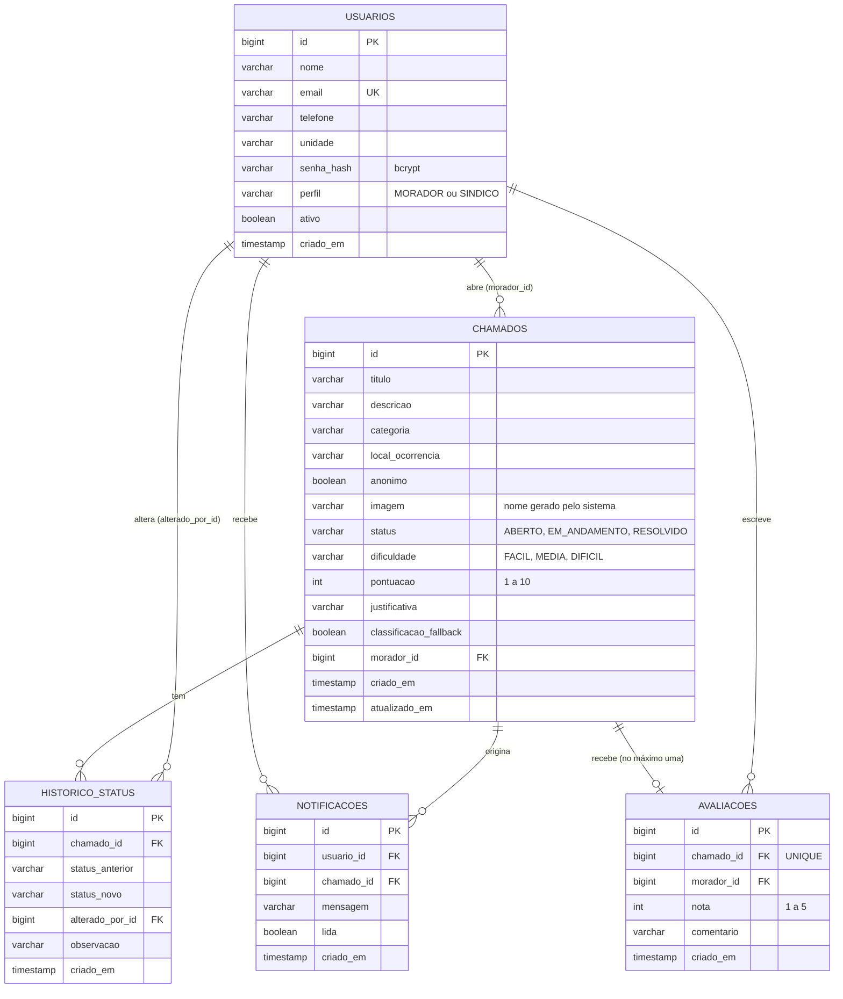
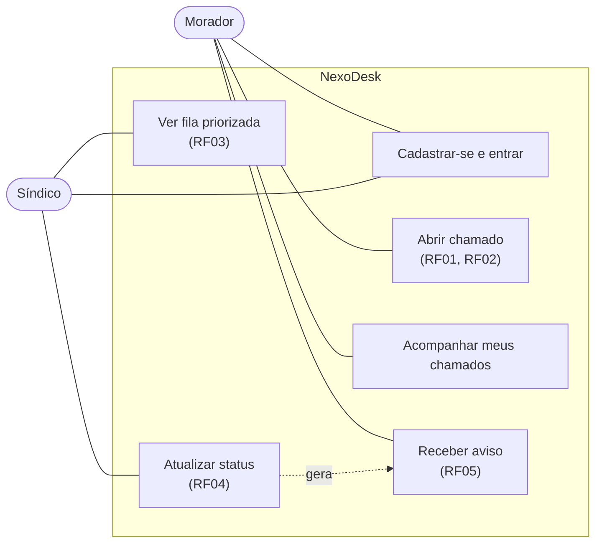
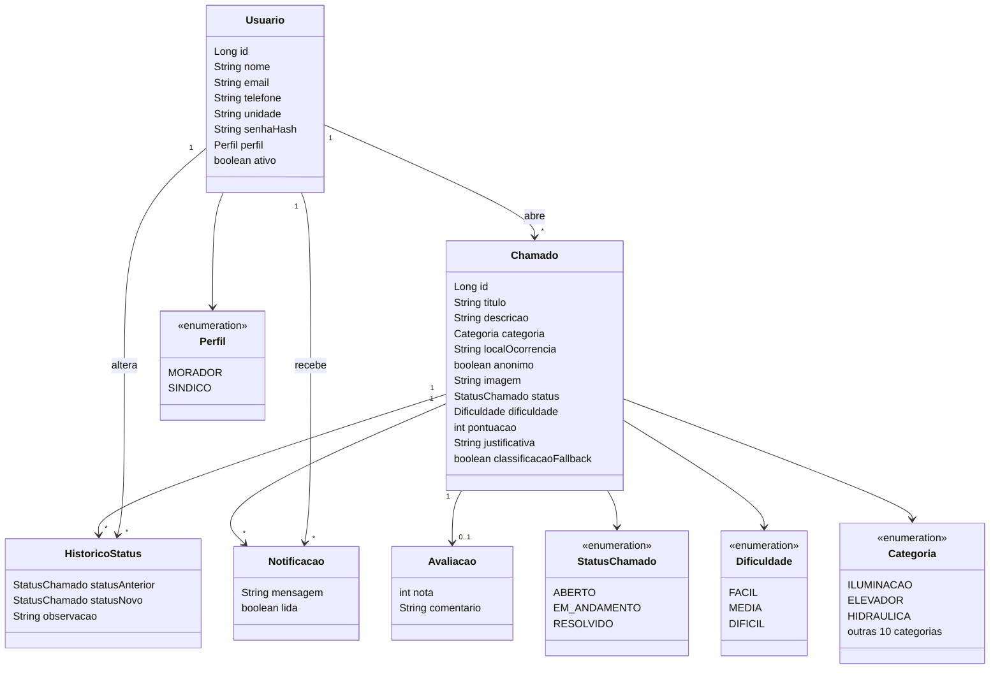
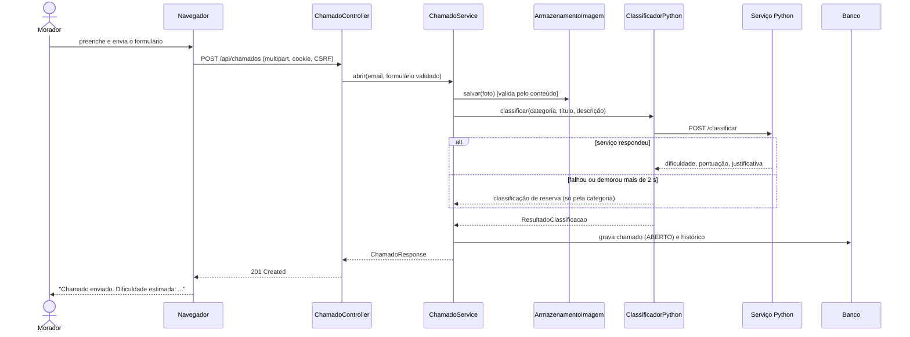
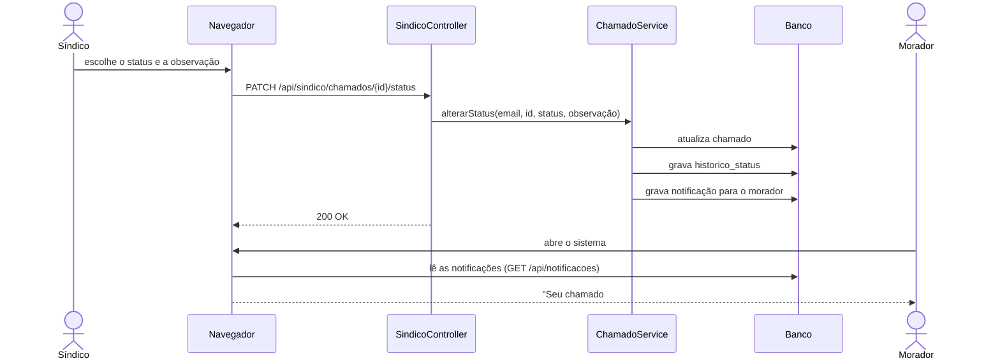

# NexoDesk: Documentação técnica

Projeto A3, Projeto e Engenharia de Software. Versão do documento: 15/10/2026.
Código: este repositório (passo a passo de execução em [`../README.md`](../README.md); do protótipo antigo
para este, em [`migracao-do-aa.md`](migracao-do-aa.md)). Documentos irmãos: [`casos-de-prioridade.md`](casos-de-prioridade.md)
, [`roteiro-demonstracao.md`](roteiro-demonstracao.md) e [`indicadores-medidos.md`](indicadores-medidos.md).

> Tudo o que está marcado como **verificado** foi executado em 14 e 15/10/2026 (comandos na seção 8).
> O que não foi executado aparece em **Limitações** (seção 9).

## 1. Visão geral

O NexoDesk é um helpdesk para condomínios. O **morador** abre chamados (com foto opcional) e acompanha o
andamento. O sistema estima a **dificuldade** de resolver cada chamado e o **síndico** atende a fila
**do mais fácil para o mais difícil**. A cada mudança de status, o morador recebe um aviso.

O sistema evoluiu do protótipo "Nexo" (PHP + PyQt5). O que foi mantido, trocado e descartado está em
[`migracao-do-aa.md`](migracao-do-aa.md).

## 2. Requisitos e onde estão implementados

| Requisito | Implementação | Situação |
|---|---|---|
| RF01 Cadastrar chamado (título, descrição, categoria) | `ChamadoController.abrir` → `ChamadoService.abrir`; tela `morador.html` | verificado |
| RF02 Classificar por nível de dificuldade | `servico-prioridade/app/regras.py` (Python) chamado por `ClassificadorPython` | verificado |
| RF03 Síndico vê do mais fácil ao mais difícil | `ChamadoRepository.findByStatusInOrderByPontuacaoAscCriadoEmAsc`; tela `sindico.html` | verificado |
| RF04 Atualizar status (aberto, em andamento, resolvido) | `SindicoController.alterarStatus`; tabela `historico_status` | verificado |
| RF05 Notificar o morador | tabela `notificacoes` (aviso dentro do sistema) e e-mail por SMTP (`NotificadorEmailStatus`, desligado por padrão) | aviso interno verificado; e-mail verificado só contra servidor SMTP falso |
| RNF01 Resposta em menos de 3 s | chamada ao serviço Python com limite de 2 s e reserva automática | **medido**: pior caso 0,26 s (login com bcrypt); abrir chamado com o Python, em média 0,03 s. Em `localhost`, banco pequeno e um usuário por vez (detalhes em [`indicadores-medidos.md`](indicadores-medidos.md)) |
| RNF02 Senha criptografada | bcrypt (`SecurityConfig.passwordEncoder`) | verificado |
| RNF03 Interface responsiva | `css/app.css`; conferida em largura de celular (375 px) | verificado |

### Funcionalidades além dos requisitos do relatório

| Funcionalidade | Onde | Situação |
|---|---|---|
| Avaliação do atendimento (nota de 1 a 5 do morador, só em chamado resolvido, uma vez) | `AvaliacaoService`, tabela `avaliacoes`; média no painel do síndico | verificado |
| Minha conta (editar nome, telefone, unidade; trocar senha) | `AuthController` (`PATCH /api/auth/me`, `POST /api/auth/senha`), `conta.html` | verificado |
| Exportar a fila em CSV (abre no Excel) | `ExportadorCsv`, `GET /api/sindico/chamados/exportar.csv` | verificado |
| Acessibilidade: tamanho do texto, alto contraste, modo escuro, reduzir animações, fonte legível, link "pular para o conteúdo" | `js/acessibilidade.js`, `css/acessibilidade.css` (adaptado do protótipo `aa`) | verificado no navegador |
| Dados de demonstração (perfil `demo`) e script de inicialização (`iniciar-nexodesk.ps1`) | `DadosDemonstracao` | verificado |

## 3. Arquitetura



Camadas do backend Java (`api-java/src/main/java/br/nexodesk/`):

| Camada | Pacote | Responsabilidade |
|---|---|---|
| Apresentação | `web` | Controladores REST, objetos de entrada e saída (`Dtos`), tratamento de erros (`TratadorErros`) |
| Aplicação | `servico` | Regras de negócio: abrir chamado, fila, mudar status, notificar, guardar imagem, classificar |
| Dados | `repositorio`, `dominio` | Entidades JPA e consultas (Spring Data) |
| Configuração | `config` | Segurança (`SecurityConfig`) e criação do primeiro síndico (`InicializadorSindico`) |

**Decisão de projeto: Java + Python.** O Java concentra autenticação, regras e dados. O Python isola a
regra de dificuldade (RF02), que muda com mais frequência. Se o serviço Python cair, o Java classifica só
pela categoria (`ClassificadorLocal`) e marca `classificacaoFallback = true`; abrir chamado nunca fica bloqueado.

## 4. Modelo de dados

Migrações (Flyway): `api-java/src/main/resources/db/migration/` (V1 = esquema base; V2 = versão de concorrência do chamado e
versão de sessão do usuário). Rodam sozinhas na inicialização; bancos criados antes do Flyway entram com baseline na versão 1.
Regra de ouro: **migração publicada nunca é editada**, só se cria uma nova (um teste confere o V1).



Pontos de projeto:

- A fila usa o índice `idx_chamados_fila (status, pontuacao, criado_em)`. A pontuação cresce junto com a
  dificuldade, então ordenar por ela equivale a FACIL, MEDIA, DIFICIL; no empate, o mais antigo vem primeiro.
- `historico_status` guarda toda mudança (inclusive a abertura), formando a trilha de auditoria.
- `anonimo` esconde nome e unidade do **síndico**; o morador continua dono do chamado e recebe os avisos.
- O Hibernate só **confere** (`ddl-auto=validate`) se as entidades batem com as migrações.
- `chamados.versao` (controle de concorrência otimista) e `usuarios.versao_sessao` (invalida sessões ao trocar a senha ou desativar o usuário), da migração V2.

## 5. Regra de dificuldade (RF02)

Implementada em `servico-prioridade/app/regras.py`, como função pura (sem banco e sem rede).

1. Cada **categoria** tem uma pontuação base de 1 a 10 (por exemplo: Iluminação 2, Elétrica 6, Elevador 8, Estrutura 9).
2. **Termos** no título e na descrição somam ou subtraem pontos: gravidade (+2, como "infiltração", "gás", "preso"),
   abrangência (+1, como "bloco inteiro") e simplicidade (−2, como "lâmpada", "trocar").
3. A pontuação final é limitada de 1 a 10. Até 3 é **FÁCIL**, até 6 **MÉDIA**, acima disso **DIFÍCIL**.
4. O resultado traz uma **justificativa** em lista (ex.: `categoria ELEVADOR: base 8`, `termo 'preso': +2`),
   exibida ao síndico em "Por que essa dificuldade?".

A tabela de pontuação base existe também em `dominio/Categoria.java` (modo de reserva). O teste
`RegrasTest.pontuacaoBaseDoJavaEIgualAoPython` falha se as duas divergirem.

## 6. API

| Método e rota | Perfil | Função |
|---|---|---|
| `POST /api/auth/register` | público | cria conta de **morador** (o perfil nunca vem do cliente) |
| `POST /api/auth/login`, `POST /api/auth/logout`, `GET /api/auth/me` | público / logado | sessão por cookie |
| `GET /api/auth/sessao` | público | informa se há sessão, sem gerar erro 401 |
| `PATCH /api/auth/me` | logado | atualiza nome, telefone e unidade (e-mail e perfil não mudam) |
| `POST /api/auth/senha` | logado | troca a senha exigindo a atual (erro conta no bloqueio de tentativas) |
| `GET /api/categorias` | público | categorias do formulário |
| `POST /api/chamados` (multipart) | morador | abre chamado, com foto opcional |
| `GET /api/chamados/meus` | morador | lista os próprios chamados |
| `GET /api/chamados/{id}`, `GET /api/chamados/{id}/imagem` | dono ou síndico | detalhe com histórico, e foto |
| `POST /api/chamados/{id}/avaliacao` | dono do chamado | avalia o atendimento (nota 1 a 5); só se RESOLVIDO e uma vez |
| `GET /api/sindico/chamados?status=ativos\|todos\|ABERTO\|EM_ANDAMENTO\|RESOLVIDO` | síndico | fila do mais fácil ao mais difícil |
| `GET /api/sindico/chamados/exportar.csv?status=...` | síndico | a mesma fila em CSV (respeita o anonimato) |
| `PATCH /api/sindico/chamados/{id}/status` | síndico | muda status, gera aviso e e-mail |
| `GET /api/sindico/estatisticas` | síndico | contagens por status e dificuldade |
| `GET /api/notificacoes`, `POST /api/notificacoes/{id}/lida` | logado | avisos do usuário |

Erros saem sempre como JSON `{"erro": "...", "campos": {...}}`, sem detalhes internos.

## 7. Segurança

- **Senhas:** bcrypt; mesma mensagem de erro para e-mail inexistente e senha errada; tamanho de 8 a 72 caracteres.
- **Força bruta:** 5 senhas erradas para o mesmo e-mail e IP, ou 30 falhas de um mesmo IP, bloqueiam o login por
  15 minutos (HTTP 429). O dono da conta, vindo de outro IP, não é afetado. O contador fica em memória
  (reiniciar a API zera; atrás de proxy o IP visto é o do proxy).
- **Perfis:** cadastro público só cria morador. O primeiro síndico nasce na primeira execução
  (`InicializadorSindico`), com senha vinda de variável de ambiente ou gerada e mostrada uma única vez no console.
- **Sessão e CSRF:** cookie `HttpOnly` e `SameSite=Lax`; CSRF ativo (cookie `XSRF-TOKEN` + cabeçalho `X-XSRF-TOKEN`).
- **Cabeçalhos:** CSP restritiva (`default-src 'self'`), `X-Content-Type-Options: nosniff`, `X-Frame-Options: DENY`.
- **XSS:** o front-end insere texto do servidor só com `textContent`. O teste `PaginasEstaticasTest` varre as telas e reprova
  `innerHTML`, `eval`, script ou `style=` inline, manipuladores `onclick=`, recursos externos e campo sem rótulo.
- **CSV:** texto que começa com `=`, `+`, `-` ou `@` recebe um apóstrofo na frente (senão o Excel executaria como fórmula);
  campos com `;`, aspas ou quebra de linha vão entre aspas.
- **E-mail:** sai só depois do commit e fora da requisição; o assunto não usa o título digitado pelo usuário e o corpo
  não leva a descrição do chamado; o log mascara o endereço. Credenciais SMTP só por variável de ambiente.
- **Upload:** tipo decidido pelo **conteúdo** (JPG, PNG ou GIF), nome gerado pelo sistema, limite de 5 MB, pasta fora
  da área pública; só o dono e o síndico veem a foto.
- **Isolamento:** morador que pede chamado de outro recebe 404.
- **SQL:** consultas parametrizadas (JPA), sem concatenação.

## 8. Testes e como reproduzir

| Suíte | Resultado em 14/10/2026 | Cobre |
|---|---|---|
| Java `FluxoChamadoTest` | 30 testes | cadastro, login, bloqueio por tentativas, sessão, CSRF, abertura e classificação, fila ordenada, anonimato, status + aviso, avaliação, minha conta, CSV, e-mail, isolamento entre moradores, upload |
| Java `PaginasEstaticasTest` | 6 testes | guarda das telas: CSP, XSS, rótulos de formulário, acessibilidade |
| Java `ExportadorCsvTest` | 5 testes | escape de campos e proteção contra fórmula |
| Java `EnviadorEmailSmtpTest` | 4 testes | envio SMTP real contra servidor falso local (GreenMail), falha do servidor não derruba, texto do e-mail |
| Java `LimitadorTentativasLoginTest` | 7 testes | janela de 15 min, limite por e-mail+IP e por IP, expiração, zerar no sucesso |
| Java `DadosDemonstracaoTest` | 2 testes | perfil `demo` cria 8 chamados com histórico e avisos, e não duplica |
| Java `ClassificadorPythonTest` | 6 testes | cliente do serviço Python (resposta válida, erro 500, valores inválidos, serviço fora do ar, HTTP/1.1) |
| Java `RegrasTest` | 3 testes | limites de dificuldade, igualdade Java x Python, assinatura de imagem |
| Python `test_regras.py` | 12 testes | regras de dificuldade e endpoint `/classificar` |

Total: **63 testes Java e 12 Python, todos passando (15/10/2026).** A suíte Java passou **nos dois bancos**: H2 em
memória (padrão) e **MySQL 8.4.9** real (variáveis `NEXODESK_TEST_DB_*`, ver README). Nos dois, o Hibernate roda com
`ddl-auto=validate`, ou seja, recusa subir se as entidades não baterem com as migrações. Além deles, o fluxo completo foi executado com os dois
serviços no ar, por HTTP e pelo navegador (com o Python real, `classificacaoFallback = false`), e o script
`iniciar-nexodesk.ps1` foi executado com o perfil `demo` (8 chamados classificados pelo Python).

```powershell
cd api-java;           .\mvnw.cmd test
cd servico-prioridade; .\.venv\Scripts\python.exe -m pytest -q
```

Para executar o sistema inteiro com um comando (Java, Python e, se quiser, dados de exemplo):
`.\iniciar-nexodesk.ps1` ou `.\iniciar-nexodesk.ps1 -Perfil demo` (detalhes no README).

## 9. Limitações e próximos passos

- **E-mail (RF05):** implementado e testado contra um servidor SMTP falso, mas vem **desligado** e nunca foi testado com um
  provedor real (Gmail etc.). Ligar exige o perfil `email` e variáveis de ambiente (ver README).
- **Troca de senha:** não encerra as outras sessões abertas do mesmo usuário.
- **RNF01:** medido só em `localhost`, com banco pequeno e uma pessoa por vez. Não há teste de carga (muitos usuários ao mesmo
  tempo) nem medição com o banco em outra máquina.
- Um único condomínio; sem paginação da fila; sem recuperação de senha; sem HTTPS (necessário para publicar fora do `localhost`).
- Arquivos de foto não são removidos se o banco recusar a gravação (arquivo órfão).
- Os diagramas UML do relatório (Canva) precisam ser conferidos contra os desta documentação.

## 10. Diagramas UML

### 10.1 Casos de uso



> O relatório fala em 5 casos de uso; o código implementa os 6 acima (o 1 e o 6 podem ser agrupados).

### 10.2 Classes (domínio)



### 10.3 Sequência: abertura de chamado



### 10.4 Sequência: mudança de status e aviso


